# ANSYS & COMSOL Simulation Library

**About 55 self-directed and coursework simulation studies: CFD, heat transfer, battery thermal management, multiphase flow, rotating machinery, structural FEA and multiphysics.**
Mehdi Hasan · Mechanical Engineering, Islamic University of Technology (IUT) · ANSYS Workbench 2024 R2 (Fluent, CFX, Mechanical) · COMSOL Multiphysics 6.3

| 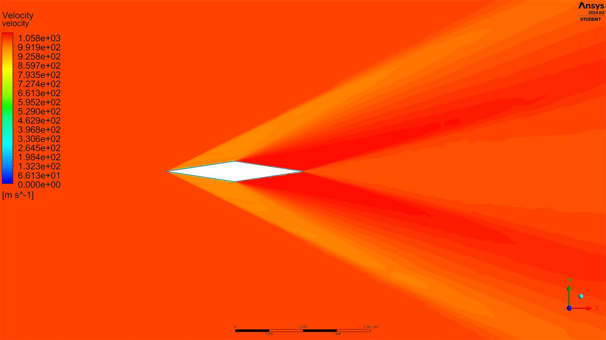 | 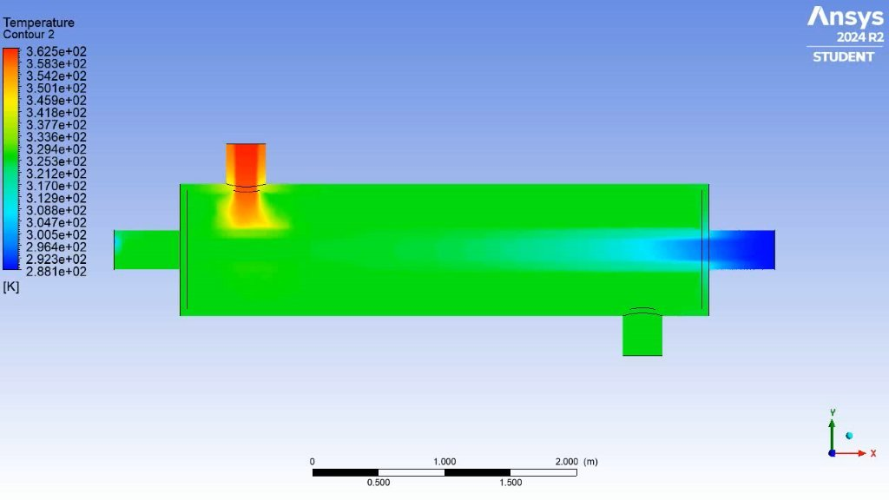 | 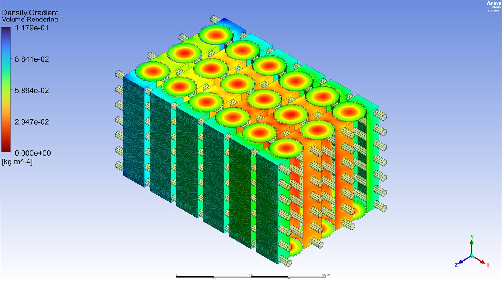 |
|---|---|---|
| Supersonic double wedge: oblique shocks | Shell-and-tube heat exchanger: conjugate heat transfer | Li-ion battery module: thermal management |

### At a glance

| Category | Studies | Solvers |
|---|---|---|
| External and compressible aerodynamics | 7 | Fluent (density- and pressure-based) |
| Rotating machinery and swirling flow | 6 | Fluent (MRF / sliding mesh, k-ε / k-ω SST) |
| Multiphase and free-surface flow | 3 | Fluent VOF |
| HVAC and indoor air | 4 | Fluent, CFX |
| Heat exchangers and heat transfer | 6 | Fluent (conjugate heat transfer), UDF |
| Battery thermal management (BTMS) | 3 | Fluent (cell heat generation, liquid cooling, PCM) |
| Structural FEA | ≈ 19 | ANSYS Mechanical (static, prestressed modal, fatigue, contact) |
| Thermal FEA | 3 | ANSYS Mechanical (steady-state and transient thermal) |
| Multiphysics | 1 (+1) | COMSOL (corona discharge / EHD) |

---

## Contents

1. [Why this library exists](#1-why-this-library-exists)
2. [Common workflow and theory](#2-common-workflow-and-theory)
3. [External and compressible aerodynamics](#3-external-and-compressible-aerodynamics)
4. [Rotating machinery and swirling flow](#4-rotating-machinery-and-swirling-flow)
5. [Multiphase flow](#5-multiphase-flow)
6. [Heat exchangers and heat transfer](#6-heat-exchangers-and-heat-transfer)
7. [Battery thermal management](#7-battery-thermal-management)
8. [HVAC and indoor air](#8-hvac-and-indoor-air)
9. [Structural and thermal FEA](#9-structural-and-thermal-fea)
10. [Multiphysics (COMSOL)](#10-multiphysics-comsol)
11. [Complete catalogue](#11-complete-catalogue)
12. [Applications and skills](#12-applications-and-skills)
13. [Repository contents and how to open files](#13-repository-contents-and-how-to-open-files)
14. [References](#14-references)

---

## 1. Why this library exists

Coursework (Computational Mechanics, Fluid Mechanics, Heat Transfer, Aerodynamics, Machine Design) teaches the theory. This library is where I practised turning that theory into **working simulation set-ups**: geometry, meshing, boundary conditions, solver choice, convergence and post-processing, across as many physics as I could reach with student licences. Several studies fed directly into my projects (the EHD ionic thruster (`ehd-ionic-thruster` repository), aerofoil work for the teardrop panel-method solver (`teardrop-panel-method` repository), and battery-cooling studies).

> **Raw solver files are not included.** The original ANSYS project folders are about 28 GB, far beyond GitHub's limits. This repository holds the exported images, animations, small complete project archives (`.wbpz`) and the COMSOL model. Full projects are available on request.

---

## 2. Common workflow and theory

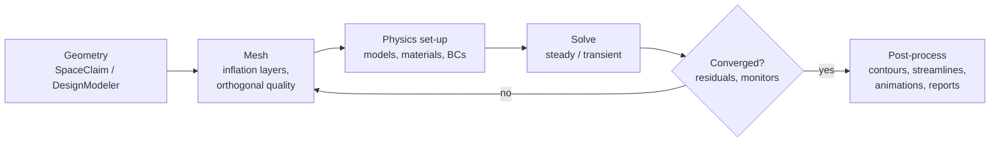

**Governing equations used across the CFD studies**

| Physics | Equations / models |
|---|---|
| Fluid flow | Continuity and Reynolds-averaged Navier–Stokes: $\nabla\cdot(\rho\mathbf u)=0$, $\ \rho\,D\mathbf u/Dt = -\nabla p + \nabla\cdot\boldsymbol\tau + \mathbf f$ |
| Turbulence | Realizable k-ε (internal and industrial flows), k-ω SST (aerofoils, adverse pressure gradients, separation) |
| Compressible flow | Ideal-gas density, energy equation, density-based solver for supersonic cases; shocks resolved by mesh refinement |
| Heat transfer | Energy equation in fluid; conduction in solids; **conjugate heat transfer** couples them at interfaces |
| Multiphase | **Volume of Fluid (VOF):** one momentum equation, transport of volume fraction α; surface tension |
| Rotating parts | Moving reference frame (MRF) / rotating walls for impellers, stirred tanks, rotating cylinders |
| Phase change | Enthalpy–porosity method; custom heat sources via **user-defined functions (UDF)** |

**FEA** uses linear elasticity, $[K]\{u\} = \{F\}$, with SOLID186/187 (quadratic tetra/hexa), SHELL181, BEAM188 and PLANE182 (axisymmetric) elements, contact pairs (CONTA174/TARGE170) and the Fatigue Tool (S–N approach). Thermal FEA uses SOLID279/291 elements with conduction and convection boundary conditions.

---

## 3. External and compressible aerodynamics

### 3.1 NACA aerofoil (Fluent, 2D)

| 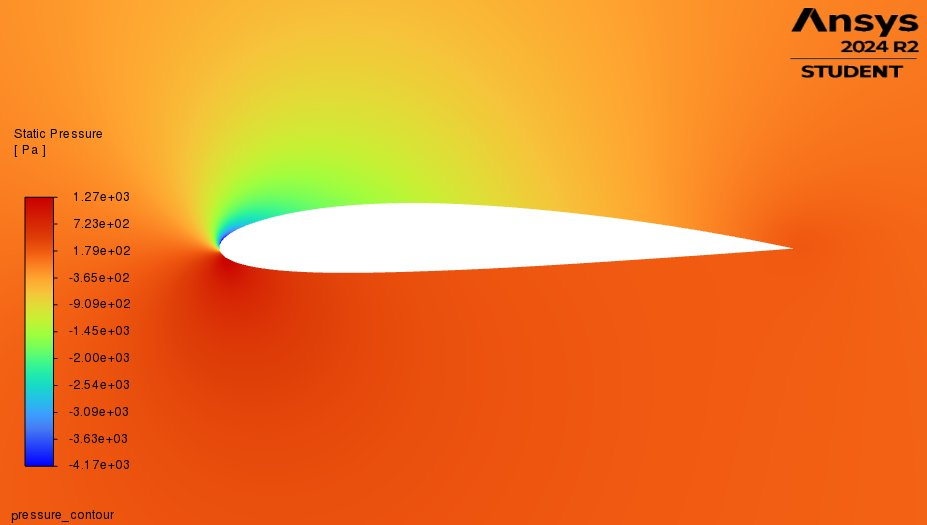 | 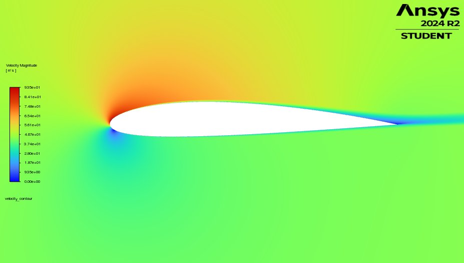 | 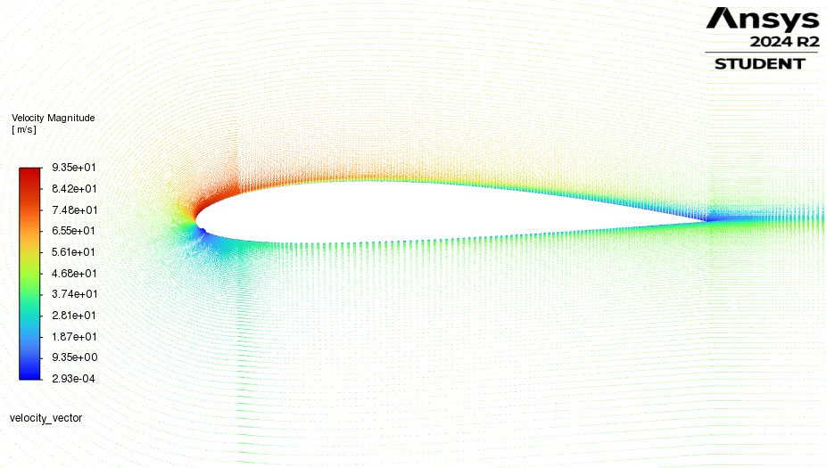 |
|---|---|---|
| Static pressure: stagnation at the leading edge, suction over the upper surface | Velocity magnitude: acceleration over the suction side, wake | Velocity vectors near the surface |

The pressure difference between lower and upper surfaces is the source of lift. The same physics, solved inviscidly, is the subject of my panel-method project (`teardrop-panel-method` repository).

### 3.2 Convergent–divergent nozzle (Fluent, compressible)

| 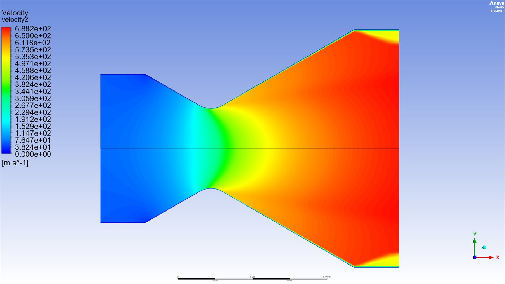 | 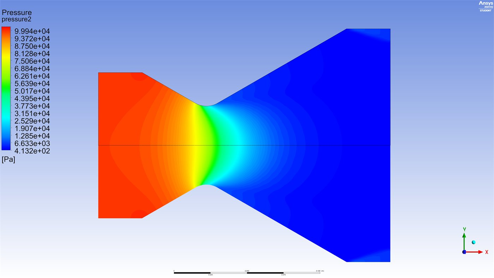 |
|---|---|
| Velocity: flow chokes at the throat (Mach 1) and accelerates to supersonic speed in the diverging section | Pressure falls continuously through the nozzle |

Quasi-1D theory: $\dfrac{A}{A^*} = \dfrac{1}{M}\left[\dfrac{2}{\gamma+1}\left(1+\dfrac{\gamma-1}{2}M^2\right)\right]^{\frac{\gamma+1}{2(\gamma-1)}}$. Animations: [`velocity.mp4`](studies/cfd-external/02-convergent-divergent-nozzle/velocity.mp4), [`pressure-evolution.mp4`](studies/cfd-external/02-convergent-divergent-nozzle/pressure-evolution.mp4), [`velocity-full.mp4`](studies/cfd-external/02-convergent-divergent-nozzle/velocity-full.mp4), [`pressure-full.mp4`](studies/cfd-external/02-convergent-divergent-nozzle/pressure-full.mp4).

### 3.3 Rocket nozzle and exhaust plume (Fluent)

| 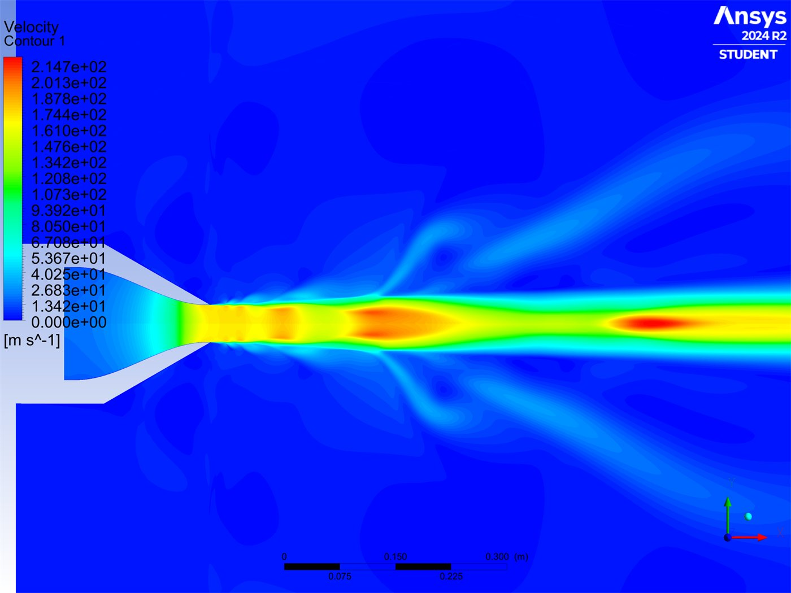 | 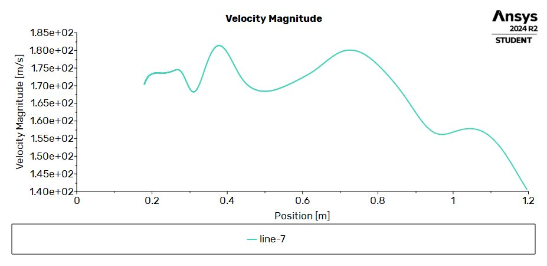 |
|---|---|
| Velocity in the nozzle and exhaust jet | Velocity along a line through the jet |

A NASA-style nozzle case. An imperfectly expanded jet forms alternating expansion fans and compression waves downstream of the exit (shock cells) until its pressure matches ambient; the velocity oscillation along the jet reflects this.

### 3.4 Supersonic flow over a double wedge (Fluent, density-based)

|  | 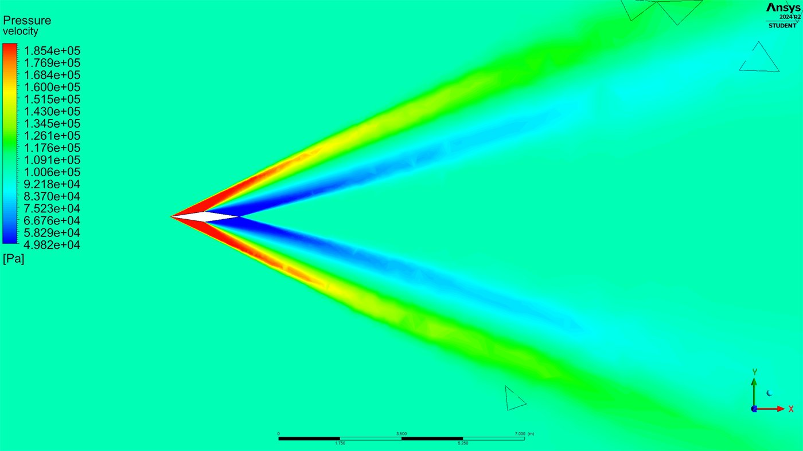 |
|---|---|
| Oblique shocks at the leading edge and expansion at the shoulder | Pressure jumps across the shocks |

Compare with oblique-shock (θ–β–M) theory: $\tan\theta = 2\cot\beta\,\dfrac{M_1^2\sin^2\beta-1}{M_1^2(\gamma+\cos2\beta)+2}$.

### 3.5 Projectile in compressible flow: drag parametric study (Fluent + Design Points)

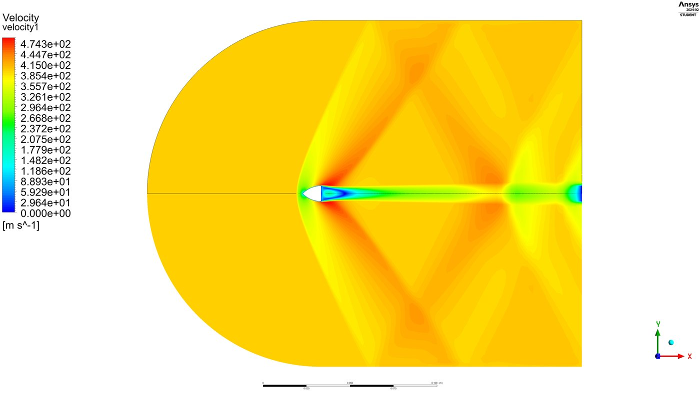

A **parametric design-point study** in ANSYS Workbench: a sketch radius of the projectile profile (*R3*) was varied and drag recorded automatically for each design point.

| Design point | R3 (mm) | Drag coefficient C_D | Drag force (N) |
|---|---|---|---|
| DP0 | 15 | 0.1886 | 4.545 |
| DP1 | 20 | 0.1899 | 4.575 |
| DP2 | 25 | 0.1966 | 4.737 |
| DP3 | 30 | 0.2038 | 4.911 |
| DP4 | 35 | 0.2114 | 5.093 |
| DP5 | 40 | 0.2158 | 5.200 |
| DP6 | 50 | 0.2235 | 5.385 |
| DP7 | 300 | 0.2465 | 5.940 |

Drag rises steadily with R3: a **31 % increase** in C_D from the sharpest (15 mm) to the bluntest (300 mm) shape, consistent with a blunter profile producing a stronger bow shock and higher wave drag. Raw export: [results-export.pdf](studies/cfd-external/05-projectile-compressible-flow/results-export.pdf).

### 3.6 Flow over a cylinder: vortex shedding (Fluent, transient)

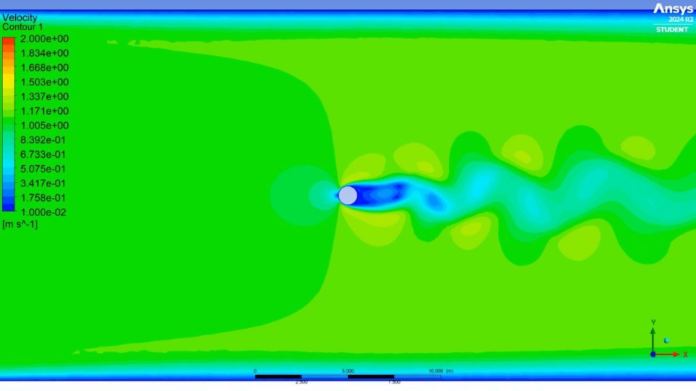

Unsteady wake behind a circular cylinder: alternating vortices form a **von Kármán vortex street** at a Strouhal number $St = fD/U \approx 0.2$ over a wide Reynolds-number range. Animation: [`vortex-shedding.mp4`](studies/cfd-external/06-flow-over-cylinder/vortex-shedding.mp4).

*Also set up:* convergent nozzle (`conv_nozzle_project`).

---

## 4. Rotating machinery and swirling flow

| 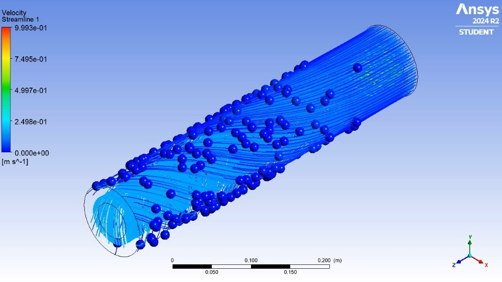 | 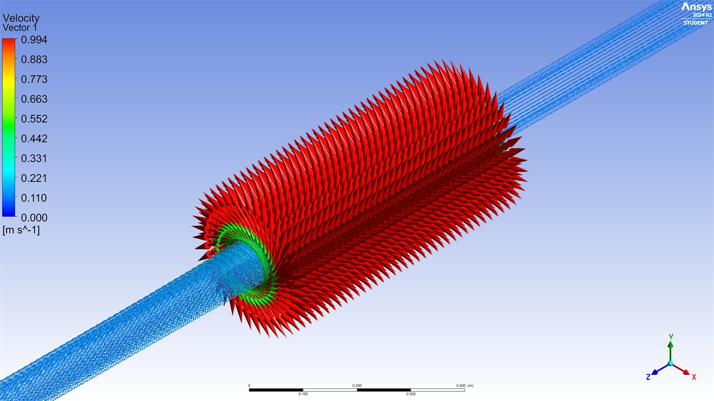 |
|---|---|
| **Flow inside a rotating cylinder:** swirling streamlines | **Finned cylinder with a rotating middle section:** velocity on the fins |
| 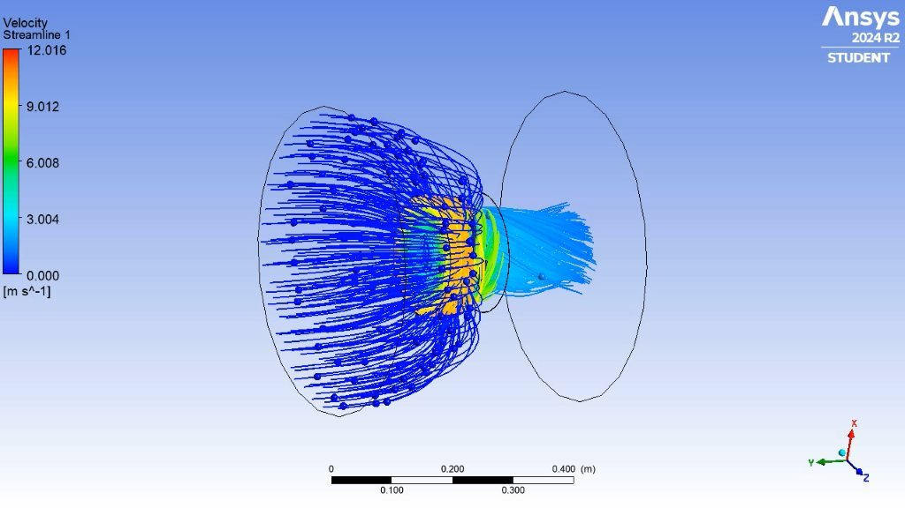 | 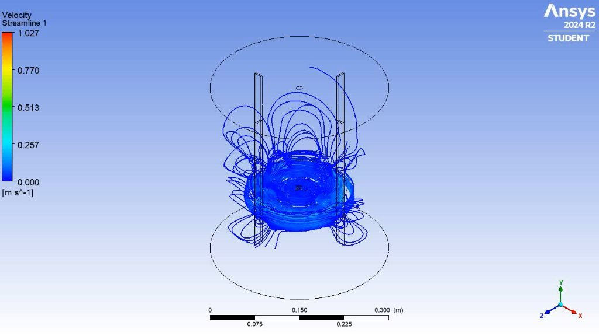 |
| **Axial impeller:** streamlines through the rotor | **Stirred tank:** circulation loops from the impeller |

| Study | What it shows | Animations |
|---|---|---|
| Rotating cylinder | Swirl development and secondary flow with a rotating wall | [streamlines](studies/cfd-rotating/07-rotating-cylinder/streamlines.mp4), [streamlines 2](studies/cfd-rotating/07-rotating-cylinder/streamlines-2.mp4) |
| Finned cylinder, rotating middle section | Moving-wall boundary on a finned shaft | [streamlines](studies/cfd-rotating/08-finned-rotating-cylinder/streamlines.mp4) |
| Axial impeller | Rotor flow with MRF | [streamlines](studies/cfd-rotating/09-axial-impeller/streamlines.mp4) |
| Stirred tank (mixing vessel) | Impeller-driven jet and the circulation loops it sets up | [streamlines](studies/cfd-rotating/10-stirred-tank/streamlines.mp4), [pressure](studies/cfd-rotating/10-stirred-tank/pressure.mp4), [vectors](studies/cfd-rotating/10-stirred-tank/vectors.mp4), [velocity](studies/cfd-rotating/10-stirred-tank/velocity.mp4) |
| **Vortex (Ranque–Hilsch) tube** | Swirl splits compressed air into a hot outer stream and a cold core with no moving parts | [streamlines](studies/cfd-rotating/11-vortex-tube/streamlines.mp4), [temperature](studies/cfd-rotating/11-vortex-tube/temperature.mp4), [pressure](studies/cfd-rotating/11-vortex-tube/pressure.mp4) |
| Simple turbine passage | Turbine flow set-up | (no exported media) |

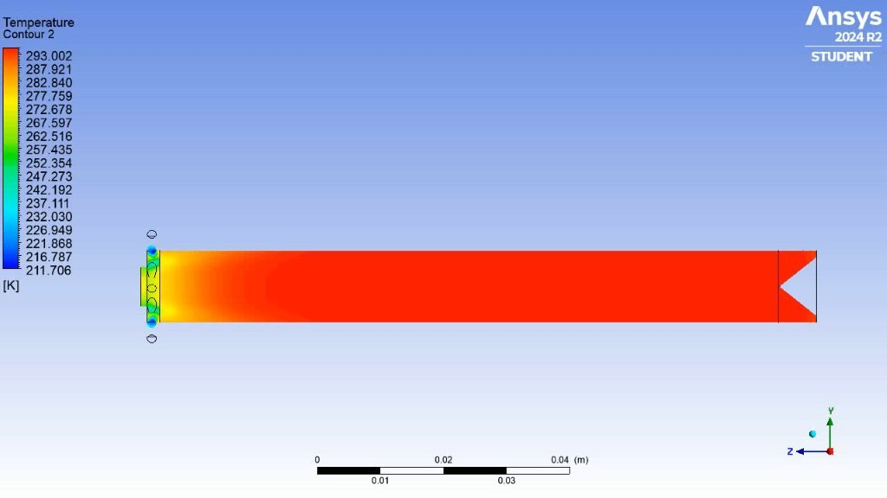

*Vortex tube: temperature separation along the tube, with the energy-separation effect resolved by compressible swirling flow.*

---

## 5. Multiphase flow

| 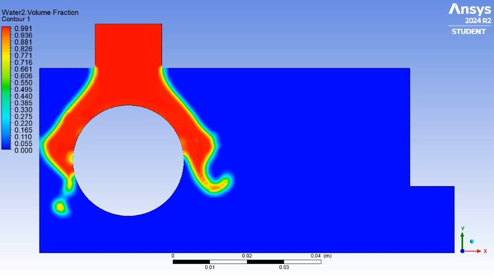 | 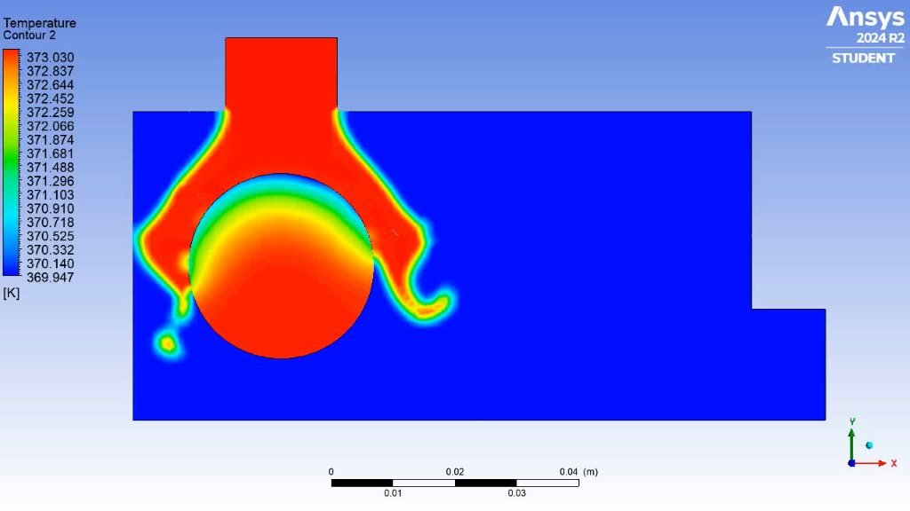 |
|---|---|
| **Two-phase VOF:** water–air interface around a circular body | Temperature field in the same case |

- **Two-phase VOF** (transient): interface tracking with surface tension and heat transfer. [Volume fraction](studies/cfd-multiphase/12-two-phase-vof/volume-fraction.mp4) · [temperature](studies/cfd-multiphase/12-two-phase-vof/temperature.mp4) · [volume render](studies/cfd-multiphase/12-two-phase-vof/volume-render.mp4)
- **Tank discharge:** draining under gravity; the free surface falls following Torricelli, $v=\sqrt{2gh}$. [Contour](studies/cfd-multiphase/13-tank-discharge/contour.jpg)
- **Tank filling** (set-up).

---

## 6. Heat exchangers and heat transfer

### 6.1 Shell-and-tube heat exchanger: conjugate heat transfer

|  | 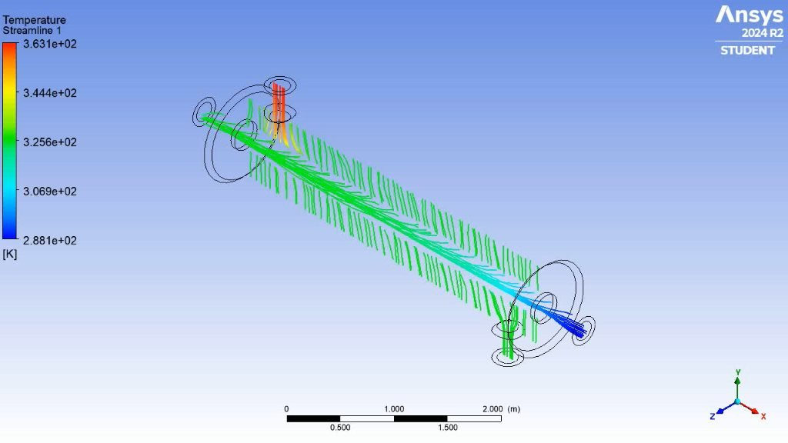 |
|---|---|
| Temperature: hot tube-side fluid heats the shell-side stream | Shell-side streamlines around the tube bundle |

Fluid and solid energy equations are solved together, so the wall temperature is a result, not an input. Compare with the LMTD design method: $\dot Q = UA\,\Delta T_{lm}$. Animations: [temperature](studies/heat-transfer/14-shell-and-tube-heat-exchanger-cht/temperature.mp4), [streamlines](studies/heat-transfer/14-shell-and-tube-heat-exchanger-cht/streamlines.mp4), [velocity](studies/heat-transfer/14-shell-and-tube-heat-exchanger-cht/velocity.mp4), [vectors](studies/heat-transfer/14-shell-and-tube-heat-exchanger-cht/vectors.mp4).

### 6.2 Other heat-transfer studies

| Study | Description | Media |
|---|---|---|
| **Automobile radiator** | Coolant tubes and air-side heat rejection through the radiator core | [contour 1](studies/heat-transfer/15-automobile-radiator/contour-1.jpg), [contour 2](studies/heat-transfer/15-automobile-radiator/contour-2.jpg) |
| **Critical radius of insulation** | Insulated pipe: adding insulation *increases* heat loss until $r_{cr} = k/h$, then decreases it | [temperature](studies/heat-transfer/16-critical-insulation-radius/temperature.jpg) |
| **Rectangular fins with PCM (UDF)** | Fin-enhanced heat sink with a phase-change material, using a user-defined function (UDF) | [1](studies/heat-transfer/17-rectangular-fins-with-pcm-udf/contour-1.jpg), [2](studies/heat-transfer/17-rectangular-fins-with-pcm-udf/contour-2.jpg), [3](studies/heat-transfer/17-rectangular-fins-with-pcm-udf/contour-3.jpg) |
| Simple heat exchanger; heat exchanger 1 | Counter-flow exchanger set-ups (solved; no exported media) | |

---

## 7. Battery thermal management

Lithium-ion cells must stay at about **15–35 °C** with a small cell-to-cell spread; above that, ageing accelerates and thermal runaway becomes possible. These studies compare cooling strategies.

|  | 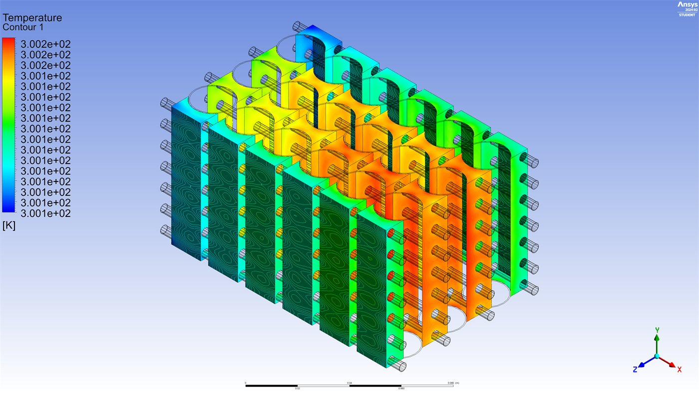 |
|---|---|
| **Multi-cell Li-ion module:** temperature distribution under heat generation | Cells embedded in an **aluminium block** heat spreader |

| 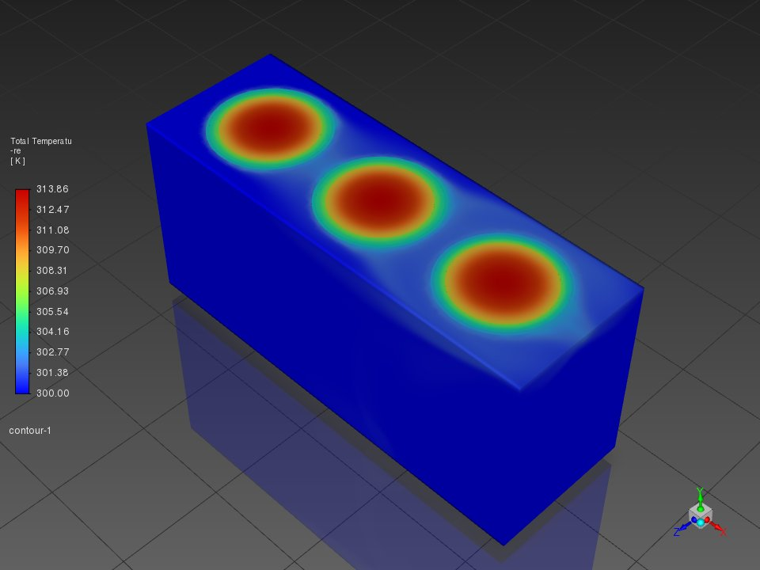 | 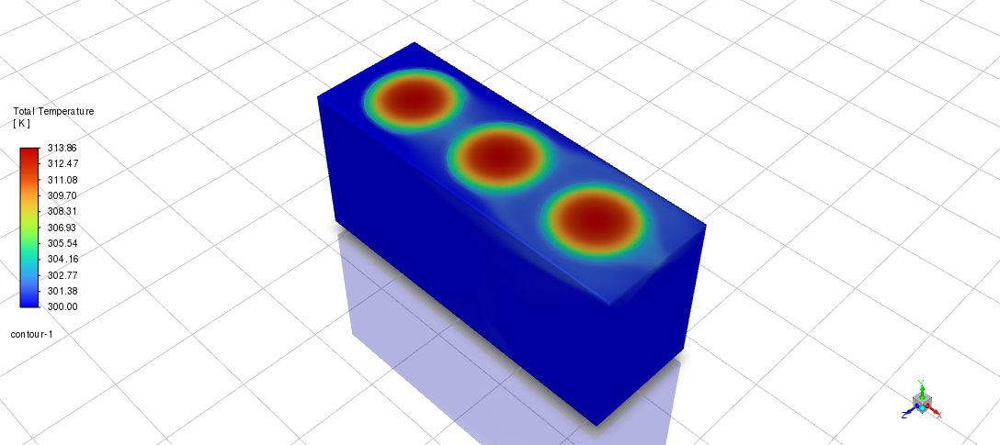 |
|---|---|
| **Hybrid BTMS, 3 cells:** cell temperature with combined cooling | Temperature contour in the cooling medium |

| Study | Cooling concept | Media |
|---|---|---|
| Li-ion module | Cells in an aluminium heat-spreader block | [volume render](studies/battery-thermal/18-li-ion-module/volume-render.jpg), [contour 1](studies/battery-thermal/18-li-ion-module/contour-1.jpg), [contour 2](studies/battery-thermal/18-li-ion-module/contour-2.jpg) |
| Hybrid BTMS (3 cells) | Hybrid cooling around three cylindrical cells; mesh quality checked by orthogonal-quality histogram | [cell temperature animation](studies/battery-thermal/19-hybrid-btms-3-cell/cell-temperature.mp4), [mesh quality](studies/battery-thermal/19-hybrid-btms-3-cell/mesh-orthogonal-quality.jpg) |
| Channel-cooled BTMS | Cell with casing and liquid-cooling channel (set-up) | |

Heat generation follows Bernardi's simplified model, $\dot q = I^2R_{int} - IT\,\dfrac{\partial E_{oc}}{\partial T}$.

---

## 8. HVAC and indoor air

| Study | Description |
|---|---|
| HVAC office | Office air distribution (set-up) |
| HVAC office 2 | Air distribution in an office (solved, Fluent) |
| Ventilation in a room with ducts | Duct-fed room ventilation, stagnant zones (solved, Fluent) |
| Radiator-heated room (CFX) | Natural convection from a radiator (ANSYS CFX set-up) |

These cases have no exported pictures; the set-ups are in the original project files.

---

## 9. Structural and thermal FEA

| 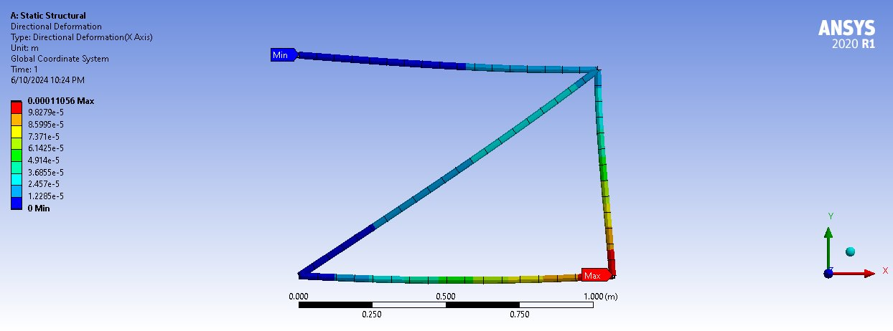 | 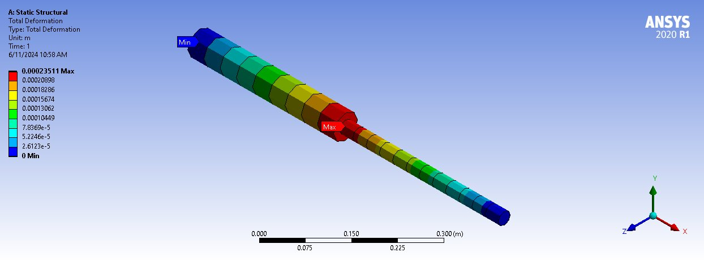 | 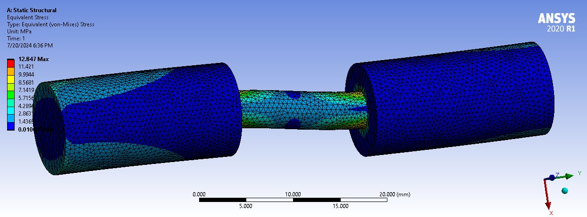 |
|---|---|---|
| 1D truss (line bodies): axial deformation | Stepped bar under axial load | Circular stepped shaft |
| 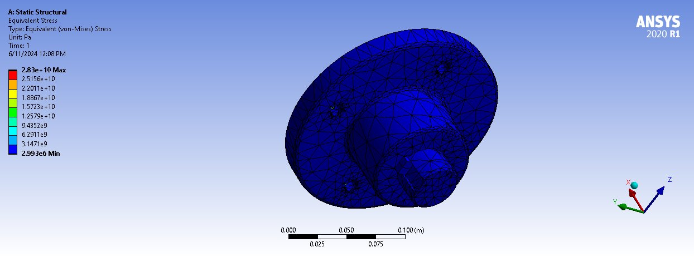 | 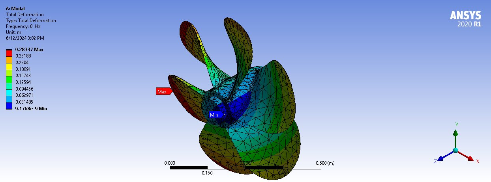 | 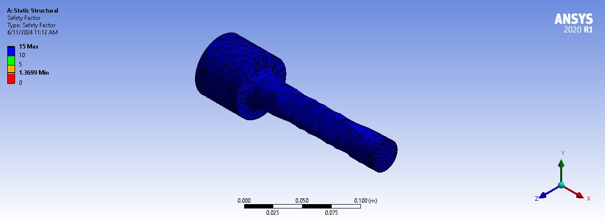 |
| Flange coupling: stress | Propeller: stress and deformation | Fatigue analysis: life / safety factor |

Analysis types were read from each project's solver input file (`ds.dat`):

| Study | Analysis | Elements | Material (from model) |
|---|---|---|---|
| 1D truss | Static structural | BEAM188 line bodies | Steel, E = 200 GPa |
| 1D stepped bar | Static structural | BEAM188 | Aluminium, E = 70 GPa |
| 1D simply supported bar | Static structural (set-up) | | |
| Axial bar / self-weight bar | Static structural | | |
| Steel frame | Static structural | BEAM188 3D frame | Structural steel, E = 200 GPa |
| Line body model | Static structural | BEAM188 | Steel, E = 200 GPa |
| Axisymmetric model | Static structural, 2D axisymmetric | PLANE182 | E = 30 GPa (concrete) |
| Tunnel | Static structural | SHELL181 + solids | Concrete, E = 30 GPa |
| Chair (steel) | Static structural | SOLID187 | Steel, E = 200 GPa |
| Chair (timber) | Static structural with contacts | SOLID186/187 + CONTA174/TARGE170 | Wood, E = 8 GPa |
| Knuckle joint | Static structural with contacts | SOLID186/187 + contact pairs | Steel, E = 200 GPa |
| Contact study | Static structural with contact | SOLID186/187 + contact pairs | Steel, E = 200 GPa |
| Fatigue | Static structural + Fatigue Tool | SOLID187 | Steel, E = 200 GPa |
| Flywheel | Static structural | SOLID187 | E = 110 GPa (grey cast iron) |
| Sign post (Exp 04) | Static structural | Shells, solids, beams | Steel (US units) |
| Project 1 | Static structural + **prestressed modal** (perturbation) | SOLID186 | Steel |
| Steady thermal 1 / 2 | Steady-state thermal | SOLID279 | |
| Fin heat transfer | Steady-state thermal | SOLID279/291 | Steel |

Hand checks: axial bars $\delta = \sum \dfrac{F L_i}{A_i E}$; self-weight $\delta = \dfrac{\rho g L^2}{2E}$; truss members by the method of joints; fins $\eta_f = \dfrac{\tanh mL}{mL}$, $m = \sqrt{hP/(kA_c)}$.

---

## 10. Multiphysics (COMSOL)

- **EHD ionic thruster:** corona discharge (electrostatics + charge transport + body force on air). The model [`archives/comsol_ehd_thruster.mph`](archives/comsol_ehd_thruster.mph) belongs to my capstone project; the full write-up is in the `ehd-ionic-thruster` repository.
- A larger COMSOL model (≈ 89 MB) is not included because of size.

---

## 11. Complete catalogue

| # | Study (original folder) | Physics | Status | Media in repo |
|---|---|---|---|---|
| 1 | NACA aerofoil (`Airfoil`) | 2D external aero, Fluent | Solved | 3 images |
| 2 | Convergent–divergent nozzle (`conv_div_nozzle`) | Compressible internal, Fluent | Solved | 3 images, 4 videos |
| 3 | Convergent nozzle (`conv_nozzle_project`) | Compressible, Fluent | Set-up | |
| 4 | Rocket nozzle (`NASA_nozzle`) | Compressible jet, Fluent | Solved | 5 images |
| 5 | Supersonic double wedge (`double_widged`) | Supersonic, Fluent | Solved | 4 images |
| 6 | Projectile drag (`comp_flow_bullet`) | Compressible + design points | Solved | image, results PDF |
| 7 | Flow over cylinder (`flow_over_cyl`) | Transient wake, Fluent | Solved | still, video |
| 8 | Rotating cylinder (`rotating_cyl`) | Swirl, Fluent | Solved | 2 stills, 2 videos |
| 9 | Finned rotating cylinder (`middle_rot_cyl`) | Moving wall, Fluent | Solved | 5 images, video |
| 10 | Axial impeller (`Axial_impeller_1`) | Turbomachinery, Fluent | Solved | still, video |
| 11 | Stirred tank (`Stirred_tank`) | Mixing, Fluent | Solved | 4 stills, 5 videos |
| 12 | Vortex tube (`Vortex_tub`) | Compressible swirl, Fluent | Solved | 3 stills, 3 videos |
| 13 | Simple turbine (`Turbine_flow_simple`) | Turbomachinery, Fluent | Solved | |
| 14 | Two-phase VOF (`2_phase_VOF`) | Multiphase, Fluent | Solved | 3 stills, 3 videos |
| 15 | Tank discharge (`tank_discharge`) | Free surface, Fluent | Solved | image |
| 16 | Tank filling (`tank_fill`) | Free surface, Fluent | Solved | |
| 17 | Shell-and-tube HX, CHT (`CHT HE`) | Conjugate HT, Fluent | Solved | 4 stills, 4 videos |
| 18 | Automobile radiator | Heat transfer, Fluent | Solved | 2 images |
| 19 | Critical insulation radius | Conduction + convection, Fluent | Solved | image |
| 20 | Rectangular fins with PCM (UDF) | Phase change, Fluent UDF | Solved | 3 images |
| 21 | Simple heat exchanger | Heat transfer, Fluent | Solved | |
| 22 | Heat exchanger 1 (`heat_exch1`) | Heat transfer, Fluent | Solved | |
| 23 | Li-ion battery module | BTMS, Fluent | Solved | 5 images |
| 24 | Hybrid BTMS, 3 cells | BTMS, Fluent | Solved | 7 images, video |
| 25 | Channel-cooled BTMS | BTMS, Fluent | Set-up | |
| 26 | HVAC office (`HVAC_office`) | Indoor air, Fluent | Set-up | |
| 27 | HVAC office 2 | Indoor air, Fluent | Solved | |
| 28 | Room ventilation with ducts | Indoor air, Fluent | Solved | |
| 29 | Radiator-heated room (`Radiator_room_cfx`) | Natural convection, CFX | Set-up | |
| 30 | 3D Fluent study (`3DAnsys1`) | Fluent | Set-up | |
| 31–48 | Structural studies: truss, bars, steel frame, line body, axisymmetric, tunnel, chairs, knuckle joint, contact, fatigue, flywheel, sign post, Project 1 (+ prestressed modal), `fahim`, `baal`, Lab 01, `Modal`, `MF` | Mechanical | Mostly solved | 8 images, 4 archives |
| 49–51 | Thermal: steady thermal, transient thermal, fin | Mechanical thermal | Solved | |
| 52 | EHD thruster (`thruster1.mph`) | COMSOL corona discharge | Solved | model file |

---

## 12. Applications and skills

| Area | Where these studies apply |
|---|---|
| Aerospace | Aerofoil design, nozzles, supersonic intakes, projectile and missile drag |
| Energy and process | Heat exchangers, radiators, mixing vessels, turbines, vortex-tube spot cooling |
| Electric vehicles and electronics | Battery thermal management, PCM heat sinks, fin design |
| Buildings | HVAC air distribution and ventilation, thermal comfort |
| Structures and machines | Frames, tunnels, couplings, joints, flywheels, fatigue life |

**Skills shown:** meshing for boundary layers and shocks, choosing steady vs transient, turbulence-model selection, compressible and multiphase solvers, conjugate heat transfer, UDFs, Workbench parametric design points, contact and fatigue in Mechanical, checking results against hand calculations.

---

## 13. Repository contents and how to open files

```
ansys-comsol-simulations/
├── README.md
├── studies/
│   ├── cfd-external/       01–06  aerofoil, nozzles, wedge, projectile, cylinder wake
│   ├── cfd-rotating/       07–11  rotating cylinders, impeller, stirred tank, vortex tube
│   ├── cfd-multiphase/     12–13  VOF, tank discharge
│   ├── heat-transfer/      14–17  CHT heat exchanger, radiator, insulation, PCM fins
│   ├── battery-thermal/    18–19  Li-ion module, hybrid BTMS
│   └── structural/         20–21  truss/bars, components
└── archives/
    ├── signpost_exp04.wbpz                       ← complete ANSYS project archives
    ├── project_1a_static_prestressed_modal.wbpz
    ├── mf.wbpz, baal.wbpz
    └── comsol_ehd_thruster.mph                   ← COMSOL Multiphysics model
```

- **`.wbpz`:** ANSYS Workbench → *File → Restore Archive* (made with 2024 R2 Student).
- **`.mph`:** COMSOL Multiphysics 6.3 or newer.
- **Videos (`.mp4`):** exported by ANSYS with an MPEG-4 Part 2 codec, which **browsers and GitHub cannot preview**. Download the file and play it in VLC or Windows Media Player. A still frame of each is shown above.

## 14. References

1. ANSYS Inc., *ANSYS Fluent Theory Guide* and *ANSYS Mechanical APDL Element Reference*, Release 2024 R2.
2. H. K. Versteeg and W. Malalasekera, *An Introduction to Computational Fluid Dynamics: The Finite Volume Method*, 2nd ed. Pearson, 2007.
3. J. D. Anderson Jr., *Modern Compressible Flow*, 3rd ed. McGraw-Hill, 2003.
4. T. L. Bergman, A. S. Lavine, F. P. Incropera and D. P. DeWitt, *Fundamentals of Heat and Mass Transfer*, 7th ed. Wiley, 2011.
5. D. Bernardi, E. Pawlikowski and J. Newman, "A general energy balance for battery systems," *J. Electrochem. Soc.*, vol. 132, pp. 5–12, 1985.
6. C. W. Hirt and B. D. Nichols, "Volume of fluid (VOF) method for the dynamics of free boundaries," *J. Comput. Phys.*, vol. 39, pp. 201–225, 1981.
7. R. G. Budynas and J. K. Nisbett, *Shigley's Mechanical Engineering Design*, 10th ed. McGraw-Hill, 2015.

---

<sub>© 2024–2026 Mehdi Hasan · [Portfolio](https://mehdi-hasan.netlify.app) · [LinkedIn](https://www.linkedin.com/in/mehdi-hasan-868639245)</sub>
